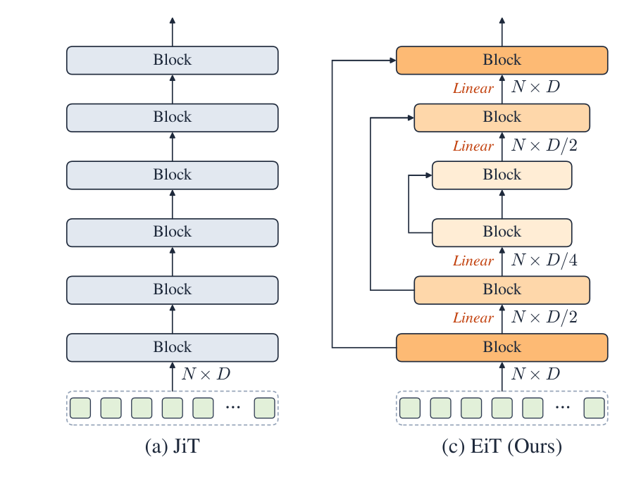

# EiT

## 1. Architecture

Official PyTorch implementation of our paper: [Exploring the Design Factors of Pixel-space Diffusion](https://arxiv.org/abs/2611.34093).

<p align="left">
  
</p>

*Figure 1(a) and (c) from the paper: JiT (left) and EiT (right).*

EiT is a pixel-space diffusion transformer with a **U-shaped channel dimension**. We keep the image token grid and the dimension of each attention head fixed, and **only vary the number of attention heads (`num_heads`) to change the channel width**:

$$D_\ell = h_\ell d,$$

where $h_\ell$ is the number of heads at layer $\ell$ and $d$ is the fixed head dimension. For example, the `4321` encoder schedule uses channel widths $(D, 3D/4, D/2, D/4)$, and the decoder reverses this schedule. In EiT-B, this corresponds to widths `(768, 576, 384, 192)` and head counts `(12, 9, 6, 3)`.


## 2. Data Preparation

We use [ImageNet-1K (ILSVRC 2012)](https://www.image-net.org/challenges/LSVRC/2012/2012-downloads.php) for both 256×256 and 512×512 experiments.

1. Download the **1,281,167 training images** (`ILSVRC2012_img_train.tar`) and **50,000 validation images** (`ILSVRC2012_img_val.tar`) from the official website. Place both archives in your ImageNet directory.

2. Extract the training and validation archives:

   ```bash
   export IMAGENET_ROOT=/path/to/imagenet
   mkdir -p "$IMAGENET_ROOT/train" "$IMAGENET_ROOT/val"
   tar -xf "$IMAGENET_ROOT/ILSVRC2012_img_train.tar" -C "$IMAGENET_ROOT/train"
   tar -xf "$IMAGENET_ROOT/ILSVRC2012_img_val.tar" -C "$IMAGENET_ROOT/val"
   ```

3. Extract the 1,000 class archives inside `train` into their own class directories:

   ```bash
   for archive in "$IMAGENET_ROOT"/train/*.tar; do
     class_name=$(basename "$archive" .tar)
     mkdir -p "$IMAGENET_ROOT/train/$class_name"
     tar -xf "$archive" -C "$IMAGENET_ROOT/train/$class_name"
   done

   export IMAGENET_TRAIN="$IMAGENET_ROOT/train"
   ```

The training directory should have the following structure:

```text
imagenet/
├── train/
│   ├── n01440764/
│   │   ├── n01440764_18.JPEG
│   │   └── ...
│   ├── n01443537/
│   └── ...
└── val/
    ├── ILSVRC2012_val_00000001.JPEG
    └── ...
```

Use the **original-resolution images** for both resolutions. The data loader resizes and center-crops images to `--img_size` at runtime and applies random horizontal flips during training. Set `--data_path` to the **`train` directory containing the class folders**. Evaluation uses the precomputed ImageNet reference statistics in `fid_stats/`, so organizing the validation images into class folders is not required for the commands below.

## 3. Installation

Clone the repository and create the environment:

```bash
git clone --branch EiT_ https://github.com/forever208/EiT.git
cd EiT

conda env create -n eit -f environment.yaml
conda activate eit
```

The environment includes Python 3.10, PyTorch 2.10.0, torchvision 0.25.0, CUDA 12.8 wheels, and the customized `torch-fidelity` package included in this repository. The `-n eit` option names the environment `eit` regardless of the name recorded in `environment.yaml`.

**For REPA training**, download the frozen DINOv2-B/14 encoder with registers before launching the distributed job:

```bash
export TORCH_HOME="$HOME/.cache/torch"

python - <<'PY'
import torch

torch.hub.load(
    "facebookresearch/dinov2:main",
    "dinov2_vitb14_reg",
    pretrained=True,
    trust_repo=True,
)
PY
```

This prepares the DINOv2 source and `dinov2_vitb14_reg4_pretrain.pth` checkpoint in the Torch Hub cache used by REPA. Existing downloads can also be selected with `--repa_encoder_repo` and `--repa_encoder_ckpt`.

## 4. Training

All commands use **one node with 8 GPUs**. `--batch_size` is the batch size **per GPU**: 256 gives a global batch size of 2,048 for EiT-B/L, and 128 gives 1,024 for EiT-H. With `--blr 5e-5`, the actual learning rates are `4e-4` and `2e-4`, respectively. Training uses a constant learning rate after 5 warmup epochs, two EMA decays (`0.9999` and `0.9996`), and class-label dropout of `0.1`.

The commands below use the model variants and experiment recipes in this branch. **EiT-L defaults to 40 layers with the `4321` schedule and maximum width 1,152.** In the large (L) model size,  we find that the **30-layer `432` and 40-layer `4321` architectures perform similarly**. Please feel free to choose either architecture.

With `--online_eval`, training computes FID and IS every `--eval_freq` epochs. It generates `--num_images` samples per evaluation, testing both EMA models with CFG=1 and the EMA selected by `--eval_ema` with `--cfg`. Results are saved to `eval_cond.log` and `eval_cfg_<cfg>.log` under `--output_dir`.

### ImageNet 256×256: EiT-B

```bash
torchrun --standalone --nnodes=1 --nproc_per_node=8 main_eit.py \
  --model EiT-B/16 --u_type 4321 --use_long_skip \
  --img_size 256 --noise_scale 1.0 --class_num 1000 \
  --batch_size 256 --blr 5e-5 --epochs 600 --warmup_epochs 5 \
  --proj_dropout 0.0 --P_mean -0.8 --P_std 0.8 \
  --compile_scope model --num_workers 16 \
  --gen_bsz 256 --num_images 50000 --eval_freq 100 \
  --cfg 2.6 --interval_min 0.1 --interval_max 1.0 --online_eval \
  --data_path "$IMAGENET_TRAIN" --output_dir outputs/eit-b-256
```

### ImageNet 256×256: EiT-L

```bash
torchrun --standalone --nnodes=1 --nproc_per_node=8 main_eit.py \
  --model EiT-L/16 --u_type 4321 --use_long_skip \
  --img_size 256 --noise_scale 1.0 --class_num 1000 \
  --batch_size 256 --blr 5e-5 --epochs 601 --warmup_epochs 5 \
  --proj_dropout 0.1 --P_mean -0.8 --P_std 0.8 \
  --compile_scope model --num_workers 16 \
  --gen_bsz 256 --num_images 50000 --eval_freq 100 \
  --cfg 2.7 --interval_min 0.1 --interval_max 1.0 --online_eval \
  --data_path "$IMAGENET_TRAIN" --output_dir outputs/eit-l-256
```

### ImageNet 256×256: EiT-H

```bash
torchrun --standalone --nnodes=1 --nproc_per_node=8 main_eit.py \
  --model EiT-H/16 --u_type 4321 --use_long_skip \
  --img_size 256 --noise_scale 1.0 --class_num 1000 \
  --batch_size 128 --blr 5e-5 --epochs 601 --warmup_epochs 5 \
  --proj_dropout 0.2 --P_mean -0.8 --P_std 0.8 \
  --compile_scope model --num_workers 16 \
  --gen_bsz 256 --num_images 50000 --eval_freq 100 \
  --cfg 2.2 --interval_min 0.1 --interval_max 1.0 --online_eval \
  --data_path "$IMAGENET_TRAIN" --output_dir outputs/eit-h-256
```

### ImageNet 256×256: EiT-H with REPA

REPA aligns features from block 20 with the frozen DINOv2-B/14 encoder using a loss weight of `0.04`.

```bash
torchrun --standalone --nnodes=1 --nproc_per_node=8 main_eit.py \
  --model EiT-H/16 --u_type 4321 --use_long_skip \
  --img_size 256 --noise_scale 1.0 --class_num 1000 \
  --batch_size 128 --blr 5e-5 --epochs 601 --warmup_epochs 5 \
  --proj_dropout 0.2 --P_mean -0.8 --P_std 0.8 \
  --repa_weight 0.04 --repa_depth 20 \
  --compile_scope model --num_workers 16 \
  --gen_bsz 256 --num_images 50000 --eval_freq 100 \
  --cfg 2.2 --interval_min 0.1 --interval_max 1.0 --online_eval \
  --data_path "$IMAGENET_TRAIN" --output_dir outputs/eit-h-repa-256
```

### ImageNet 512×512: EiT-H

At 512×512, use patch size 32 and noise scale 2.0. This keeps the image token count at 256, as in the 256×256 experiments.

```bash
torchrun --standalone --nnodes=1 --nproc_per_node=8 main_eit.py \
  --model EiT-H/32 --u_type 4321 --use_long_skip \
  --img_size 512 --noise_scale 2.0 --class_num 1000 \
  --batch_size 128 --blr 5e-5 --epochs 601 --warmup_epochs 5 \
  --proj_dropout 0.2 --P_mean -0.8 --P_std 0.8 \
  --compile_scope model --num_workers 16 \
  --gen_bsz 256 --num_images 50000 --eval_freq 100 \
  --cfg 2.2 --interval_min 0.1 --interval_max 1.0 --online_eval \
  --data_path "$IMAGENET_TRAIN" --output_dir outputs/eit-h-512
```

### ImageNet 512×512: EiT-H with REPA

```bash
torchrun --standalone --nnodes=1 --nproc_per_node=8 main_eit.py \
  --model EiT-H/32 --u_type 4321 --use_long_skip \
  --img_size 512 --noise_scale 2.0 --class_num 1000 \
  --batch_size 128 --blr 5e-5 --epochs 601 --warmup_epochs 5 \
  --proj_dropout 0.2 --P_mean -0.8 --P_std 0.8 \
  --repa_weight 0.04 --repa_depth 20 \
  --compile_scope model --num_workers 16 \
  --gen_bsz 256 --num_images 50000 --eval_freq 100 \
  --cfg 2.2 --interval_min 0.1 --interval_max 1.0 --online_eval \
  --data_path "$IMAGENET_TRAIN" --output_dir outputs/eit-h-repa-512
```

To resume training, add `--resume /path/to/checkpoint-XXX.pth` to the matching command. `--resume` takes a **checkpoint file**, not an output directory.

## 5. Evaluation

The examples below generate **50,000 images on 8 GPUs** with a **50-step Heun sampler**, CFG interval `[0.1, 1.0]`, and EMA decay `0.9999`. `--gen_bsz` is the generation batch size per GPU. Point `--resume` to your trained checkpoint, keeping the same model and `--u_type` used for training.

### EiT-B on ImageNet 256×256

```bash
torchrun --standalone --nnodes=1 --nproc_per_node=8 main_eit.py \
  --model EiT-B/16 --u_type 4321 --use_long_skip \
  --img_size 256 --noise_scale 1.0 --class_num 1000 \
  --sampling_method heun --num_sampling_steps 50 \
  --gen_bsz 256 --num_images 50000 --eval_ema 0.9999 \
  --cfg 2.5 --interval_min 0.1 --interval_max 1.0 \
  --compile_scope block --evaluate_gen \
  --data_path "$IMAGENET_TRAIN" --output_dir outputs/eit-b-256 \
  --resume outputs/eit-b-256/checkpoint-600.pth
```

### EiT-L on ImageNet 256×256

```bash
torchrun --standalone --nnodes=1 --nproc_per_node=8 main_eit.py \
  --model EiT-L/16 --u_type 4321 --use_long_skip \
  --img_size 256 --noise_scale 1.0 --class_num 1000 \
  --sampling_method heun --num_sampling_steps 50 \
  --gen_bsz 256 --num_images 50000 --eval_ema 0.9999 \
  --cfg 2.7 --interval_min 0.1 --interval_max 1.0 \
  --compile_scope block --evaluate_gen \
  --data_path "$IMAGENET_TRAIN" --output_dir outputs/eit-l-256 \
  --resume outputs/eit-l-256/checkpoint-600.pth
```


Evaluation uses the customized [torch-fidelity](https://github.com/LTH14/torch-fidelity) and the reference statistics included in `fid_stats/`. FID and IS are written to `FID.log` in `--output_dir`. The current evaluation routine removes the temporary generated PNG files after computing metrics. It still initializes the ImageNet data loader, so `--data_path` must point to a valid training directory when using `--evaluate_gen`.

## 6. Citation and Acknowledgements

If you find this repository helpful, please cite:

```bibtex
@article{ning2026exploring,
  title={Exploring the Design Factors of Pixel-space Diffusion},
  author={Ning, Mang and Zhang, Le and Salah, Albert Ali and Ertugrul, Itir Onal and Zhang, Jintao},
  journal={arXiv preprint arXiv:2611.34093},
  year={2026}
}
```

This repository is built on [JiT](https://github.com/LTH14/JiT). We thank the JiT authors for providing the base code.
